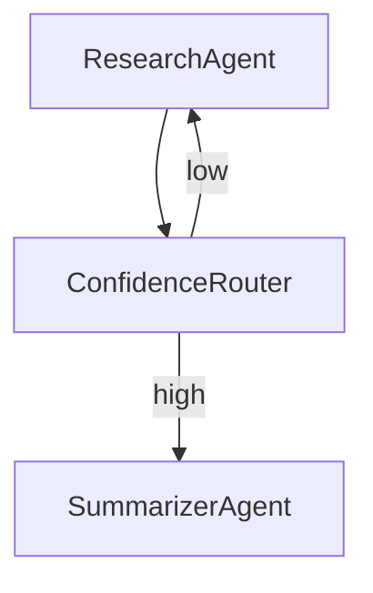

## How LangGraph Models Agent Workflows as Graphs  

---  

### Introduction  

Graph‑based representations give us a natural way to describe **data flow**, **branching logic**, and **feedback loops**—all core patterns in LLM‑driven applications. By treating each agent, tool, or function as a node and wiring them together with edges, we obtain a visual, composable, and debuggable workflow.

**LangGraph** is a lightweight Python library that turns this intuition into production‑ready code. It provides:

| Feature | What it does |
|---------|--------------|
| **Primitives** (`Node`, `Edge`, `State`) | Direct mappings to graph‑theory concepts. |
| **Builders** for DAGs and cyclic graphs | Built‑in support for conditional routing and parallel execution. |
| **Runtime** | Executes synchronously, asynchronously, or on a distributed cluster. |

The target audience is developers and data scientists who already use LLM agents (e.g., LangChain, OpenAI SDK) and need a more structured orchestration layer.

**What you’ll learn**

1. The graph primitives LangGraph provides.  
2. How to turn an LLM agent into a reusable node.  
3. How to connect nodes into complex workflows.  
4. Executing, monitoring, and scaling those graphs.  
5. Real‑world patterns you can copy straight into your projects.  

---  

## 1. Core Concepts  

| Concept | Description | Typical Use |
|---------|-------------|-------------|
| **Node** | Encapsulates an agent, tool, or pure function. Declares input & output schemas (Pydantic models or `TypedDict`). | `ResearchAgent`, `Summarizer`, `SQLExecutor` |
| **Edge** | Directed link that moves data from one node’s output to another node’s input. Can carry a **condition** or **trigger**. | `if confidence > 0.8 → Summarizer` |
| **State** | A mutable `GraphState` object shared across the execution. Supports **immutable snapshots** for checkpointing and **mutable fields** for fast updates. | Conversation history, cached documents |
| **Graph Types** | *Directed Acyclic Graph (DAG)* – safe for one‑pass pipelines.<br>*Cyclic/Feedback Graph* – enables loops, iterative refinement, or self‑improvement. | DAG: ETL pipeline.<br>Feedback: “research → critique → rewrite” loop. |

---  

## 2. Defining Agents as Graph Nodes  

LangGraph registers a class as a node with the `@graph.node` decorator. The class must implement a `run(state, **inputs)` method that returns a dictionary matching the declared output schema.

```python
from langgraph import graph, schemas
from pydantic import BaseModel
from typing import List

# ---------- Input / output schemas ----------
class SearchInput(BaseModel):
    query: str

class SearchOutput(BaseModel):
    results: List[str]

# ---------- Node definition ----------
@graph.node(name="ResearchAgent")
class ResearchAgent:
    """Calls an external web‑search tool and returns the top URLs."""

    def __init__(self, search_tool):
        self.search = search_tool          # injected for testability

    async def run(self, state: schemas.State, payload: SearchInput) -> SearchOutput:
        # The tool call is async; LangGraph will await it automatically.
        results = await self.search.run(query=payload.query, top_k=5)
        return SearchOutput(results=results)
```

**Best practices**

* **Single responsibility** – a node should do one thing (e.g., retrieval, reasoning, or formatting).  
* **Explicit schemas** – they become the contract for edge wiring and enable static validation.  
* **Dependency injection** – pass tools in `__init__` so the node can be swapped with mocks during testing.  

---  

## 3. Connecting Nodes: Building the Workflow  

After nodes are registered, the graph builder connects them. LangGraph offers three high‑level helpers:

* `add_edge(src, dst, condition=None)` – simple data flow, optional guard.  
* `if_else(condition_node, true_branch, false_branch)` – conditional routing.  
* `parallel(*branches)` – fan‑out execution; results are merged automatically.

```python
from langgraph import GraphBuilder

# ---- Instantiate the builder ------------------------------------------------
builder = GraphBuilder()

# ---- Create node instances ---------------------------------------------------
research   = ResearchAgent(search_tool=my_search)
summarizer = SummarizerAgent()
router     = ConfidenceRouter()   # returns {"high": bool}

# ---- Register nodes -----------------------------------------------------------
builder.add_node(research)
builder.add_node(summarizer)
builder.add_node(router)

# ---- Wire the graph -----------------------------------------------------------
# query → research → router
builder.add_edge("ResearchAgent", "ConfidenceRouter",
                 condition=lambda out: out["results"])

# Conditional branch: high confidence → summarizer, else → research again
builder.if_else(
    condition_node="ConfidenceRouter",
    true_branch=("SummarizerAgent",),   # go to summarizer
    false_branch=("ResearchAgent",)     # loop back for refinement
)

# Build the final graph (cyclic because of the loop)
workflow = builder.build()
```

### Visualizing the Graph  

LangGraph can emit DOT or Mermaid strings for quick inspection:

```python
print(workflow.to_dot())       # Graphviz DOT format
print(workflow.to_mermaid())   # Mermaid syntax
```

Paste the output into VS Code, a Mermaid live editor, or render it with `graphviz` to obtain a diagram such as:



---  

## 4. Executing and Monitoring Graphs  

### Runtime Modes  

| Mode | When to use | API |
|------|-------------|-----|
| **Synchronous** | Simple scripts or notebooks. | `workflow.run(state, inputs)` |
| **Asynchronous** | I/O‑bound tools, parallel branches. | `await workflow.run_async(state, inputs)` |
| **Distributed** | Large models or high‑throughput pipelines. | `workflow.deploy(cluster="ray")` (Ray, Dask, etc.) |

### State Propagation & Checkpointing  

```python
state = schemas.State()
state["conversation_id"] = "c123"
state["history"] = []

# Run with automatic checkpoint every 2 steps
result = workflow.run(
    state,
    {"query": "latest AI research"},
    checkpoint_interval=2          # serialized to the configured backend
)
```

Checkpoints are stored in a configurable backend (local file, S3, Redis). If the process crashes, you can resume from the latest snapshot.

### Logging, Tracing, and Debugging  

* **Built‑in logger** – each node emits `node_name.start`, `node_name.end`, and `node_name.error` events.  
* **Trace UI** – `workflow.visualize(trace_id)` opens an interactive HTML view showing execution times and payloads per node.  
* **Debug mode** – `builder.debug(True)` injects a `breakpoint()` after every node, useful during development.  

### Scaling  

* **Horizontal scaling** – With Ray, `workflow.deploy(cluster="ray")` distributes nodes across workers.  
* **Resource hints** – Nodes can declare `resource_requirements = {"gpu": 1}`; the scheduler respects them when placing tasks.  

---  

## 5. Real‑World Use Cases & Patterns  

### 5.1 Chatbot with Tool Use  

```
User Query → IntentRouter → (if retrieval) → ResearchAgent → Summarizer → Response
```

*Pattern*: **Fan‑out** (parallel search across several APIs) → **Fan‑in** (merge results) → **Conditional** (summarize only when enough information is found).  

### 5.2 Data‑Pipeline Orchestration  

```
Ingest → Cleaner → FeatureEngineer → Analyzer → Reporter
```

*Pattern*: Pure DAG; each node writes to a shared `DataFrame` stored in the graph state.  

### 5.3 Self‑Improving Agents  

```
Task → Execute → Critique → (if score < threshold) → FineTune → Loop
```

*Pattern*: **Cyclic graph** with a feedback edge from `Critique` back to `FineTune`. Checkpointing ensures the model state persists across iterations.  

### Pattern Library (quick reference)

| Pattern | Description | Example Nodes |
|---------|-------------|---------------|
| **Fan‑out / Fan‑in** | Run several independent agents in parallel, then aggregate. | `parallel(SearchA, SearchB, SearchC)` → `MergeResults` |
| **Map‑Reduce** | Apply a node to each element of a list, then combine. | `map(Node=Summarizer, items=doc_list)` → `Reduce(Concat)` |
| **Stateful Conversation Loop** | Keep a mutable `history` list; each turn appends and feeds back. | `ChatAgent` → `UpdateHistory` → loop back to `ChatAgent` |
| **Map‑Conditional** | Branch per item based on a predicate. | `map(Node=Router, items=queries)` → conditional edges per router output |

---  

## Conclusion  

LangGraph turns the often‑messy choreography of LLM agents into a **clear, visual graph**:

* **Composable** – Nodes are reusable, schema‑driven components.  
* **Maintainable** – Edges encode routing logic; changes are localized.  
* **Observable** – Built‑in tracing, logging, and visual diagrams give instant insight.  
* **Scalable** – Run locally, on an async loop, or across a distributed cluster with resource awareness.

Ready to experiment? Clone the official starter repository, run the `research_chatbot.py` example, and start building your own nodes. Contributions—new node types, visual plugins, or distributed backends—are welcome; the ecosystem thrives on community extensions.

**Happy graphing!**