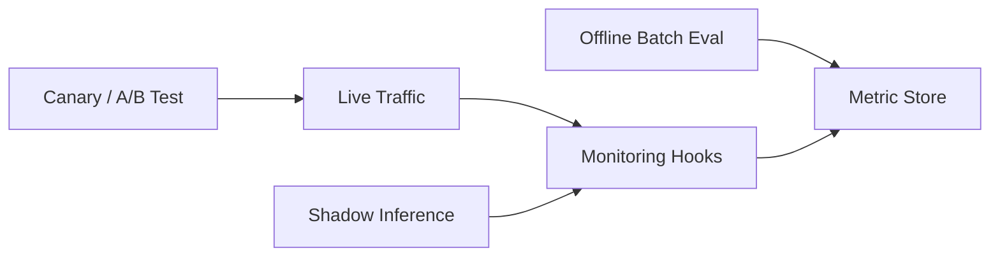

## Evaluating LLM Applications in Production  

### Introduction  
- **Context:** In the past few years, large language models (LLMs) have moved from research labs into customer‑facing products—search assistants, code generators, support chatbots, and more.  
- **Why systematic evaluation matters:** Deploying an LLM at scale introduces risks (hallucinations, bias, latency spikes), hidden costs (GPU hours, API fees), and direct impact on user experience. A repeatable evaluation process lets teams quantify these factors, catch regressions early, and make data‑driven trade‑offs.  
- **Scope & audience:** This article is aimed at ML engineers, platform architects, and product leads responsible for taking an LLM from prototype to production. It covers metrics, framework design, validation techniques, risk management, and continuous improvement.  

---  

## 1. Defining Success Metrics for Production LLMs  

| Category | Metric | Typical Target / Insight |
|----------|--------|--------------------------|
| **Performance** | Accuracy (task‑specific): BLEU, ROUGE, F1, Exact Match | > 85 % F1 on QA, BLEU ≥ 30 for translation |
| | Latency (95 th percentile) | ≤ 200 ms for real‑time chat |
| | Throughput | ≥ 500 req/s per GPU (or per inference endpoint) |
| **Business & User‑Centric** | Conversion rate (e.g., click‑through after suggestion) | +5 % lift vs. baseline |
| | Churn / Retention | Reduction in churn after bot rollout |
| | NPS / CSAT | ≥ 8/10 after interaction |
| | Task‑completion time | ≤ 30 s for multi‑turn support flow |
| **Reliability & Safety** | Failure rate (exception, timeout) | < 0.1 % of requests |
| | Hallucination frequency | < 1 % of responses flagged by fact‑check layer |
| | Toxicity score (e.g., Perspective API) | < 0.05 % above threshold |
| | Compliance checks (PII leakage) | 0 incidents per month |

> **Tip:** Separate *model‑level* metrics (accuracy, latency) from *product‑level* KPIs (conversion, NPS). Both are required to justify a deployment.  

---  

## 2. Building a Robust Evaluation Framework  

### Data Strategy  
1. **Representative production data** – Pull a stratified sample from live logs (different user segments, query lengths, language variants).  
2. **Synthetic benchmarks** – Keep canonical suites (e.g., MMLU, TruthfulQA) for regression tracking.  
3. **Continuous collection & labeling** – Deploy a lightweight annotation UI that surfaces low‑confidence outputs for human review; store results in a versioned dataset (e.g., with DVC or LakeFS).  

### Test‑Harness Architecture  



- **Offline batch** – Run nightly jobs on a fixed validation set; push metrics to a time‑series DB (Prometheus, InfluxDB).  
- **Online canary / A/B** – Route a percentage of traffic to the new model version; capture both model outputs and downstream business events.  
- **Monitoring hooks** – Instrument request IDs, prompt metadata, and model‑level logs (token usage, generation timestamps) with OpenTelemetry.  

### Automation & CI/CD Integration  

```yaml
# .github/workflows/eval.yml
name: Model Evaluation
on:
  push:
    branches: [main]
jobs:
  evaluate:
    runs-on: ubuntu-latest
    steps:
      - uses: actions/checkout@v3
      - name: Pull latest test data
        run: dvc pull -r origin test-data
      - name: Run offline eval
        run: |
          python eval/batch.py \
            --model-id ${{ secrets.MODEL_REGISTRY_ID }} \
            --data test-data/ \
            --output metrics.json
      - name: Publish metrics
        uses: mikepenz/action-junit-report@v3
        with:
          report_paths: metrics.json
      - name: Fail on regression
        run: |
          python eval/regression_check.py \
            --baseline metrics/baseline.json \
            --current metrics.json \
            --threshold 0.02
```

- **Automated dashboards** – Grafana panels ingest `metrics.json` via the Prometheus pushgateway.  
- **Regression alerts** – A simple script (`regression_check.py`) aborts the pipeline if any key metric degrades beyond a configurable threshold.  
- **Rollback criteria** – Define explicit conditions (e.g., latency > 250 ms **or** hallucination > 0.5 %) that trigger an automatic rollback to the previous model tag.  

---  

## 3. Real‑World Validation Techniques  

| Technique | When to Use | Key Implementation Details |
|-----------|------------|-----------------------------|
| **A/B & multivariate testing** | Measuring impact on conversion, CSAT, or downstream revenue. | Randomly assign users via a feature‑flag service (LaunchDarkly, Optimizely). Log both control and variant outcomes. |
| **Shadow inference / dark launch** | Safely assess model behavior on live traffic without affecting users. | Duplicate incoming requests to a “shadow” endpoint; discard responses but log them for offline analysis. |
| **Human‑in‑the‑loop evaluation** | High‑risk domains (medical, legal) or early‑stage QA. | Combine expert review (subject‑matter experts) with crowd‑sourced rating; store scores in a central audit DB. |
| **Stress & load testing** | Prior to scaling events (marketing campaigns, seasonal spikes). | Use Locust or k6 to simulate burst traffic; monitor GPU utilization, queue latency, and auto‑scaling latency. |

**Best practice:** Start with offline metrics, move to shadow inference, then progress to controlled A/B before a full rollout. This staged approach limits exposure to catastrophic failures.  

---  

## 4. Managing Risks & Compliance  

1. **Bias detection & mitigation**  
   - Run subgroup analysis (gender, ethnicity, dialect) on a curated fairness benchmark.  
   - Apply post‑processing filters (e.g., calibrated logits) or fine‑tune on debiased data.  

2. **Hallucination and factuality safeguards**  
   - Pair the LLM with a retrieval component (RAG) and enforce a “citation‑required” policy.  
   - Deploy a lightweight fact‑checking model that flags low‑confidence statements for human review.  

3. **Data privacy (GDPR/CCPA)**  
   - Mask PII in prompts before logging; store raw prompts only in encrypted, access‑controlled vaults.  
   - Provide a “right‑to‑be‑forgotten” endpoint that scrubs a user’s data from the training pipeline.  

4. **Model versioning, reproducibility, audit trails**  
   - Use a model registry (MLflow, Weights & Biases) that records Docker image hash, hyper‑parameters, training‑data snapshot, and evaluation results.  
   - Keep immutable artifact IDs; any production change must be traceable to a registry entry.  

---  

## 5. Continuous Improvement & Post‑Deployment Monitoring  

### Real‑time Dashboards & Alerting  
- **Latency heatmap** per region, **error‑rate** per endpoint, **toxicity‑spike** alerts (e.g., > 5 % increase in a 5‑minute window).  
- Set SLOs: 99 % of requests ≤ 200 ms, 99.9 % error‑free, hallucination < 0.2 % per day.  

### Feedback Loops  
1. Capture **user signals** (thumbs‑up/down, re‑asks, abandonment).  
2. Feed signals into a labeling pipeline that tags the original prompt with “success” or “failure.”  
3. Periodically **re‑train / fine‑tune** using the newly labeled set; validate against the same offline suite before promotion.  

### Scheduled Re‑evaluation  
- **Drift detection:** Compare the distribution of incoming prompts (token length, language) against the baseline dataset weekly. Trigger a retraining job if KL‑divergence > 0.05.  
- **Seasonal updates:** For domains with known cycles (e.g., holiday shopping), schedule a “quarterly refresh” of the knowledge base and re‑run the full evaluation suite.  

### Cost‑Benefit Analysis  
- Track **GPU‑hour cost** vs. **business uplift** (e.g., additional revenue per 1 % conversion gain).  
- Experiment with **model compression** (int8 quantization, LoRA adapters) and measure the trade‑off between latency reduction and any drop in F1/ROUGE.  

---  

## Conclusion  

**Key pillars** for production‑ready LLMs:  

1. **Metrics** that span technical performance, business impact, and safety.  
2. A **modular evaluation framework** integrating data pipelines, test harnesses, and CI/CD.  
3. **Real‑world validation** through staged traffic experiments and human feedback.  
4. **Risk & compliance** controls for bias, hallucination, and privacy.  
5. **Continuous monitoring** and feedback loops that keep the model aligned with evolving data and business goals.  

Production LLMs are not “set‑and‑forget” components; they require ongoing measurement, disciplined rollback mechanisms, and a culture of responsible AI.  

**Call to action:**  
- Formalize a metric dashboard.  
- Wire your CI pipeline to run nightly regressions.  
- Launch a shadow‑inference endpoint.  

A structured evaluation pipeline turns raw LLM capability into reliable, responsible AI at scale.