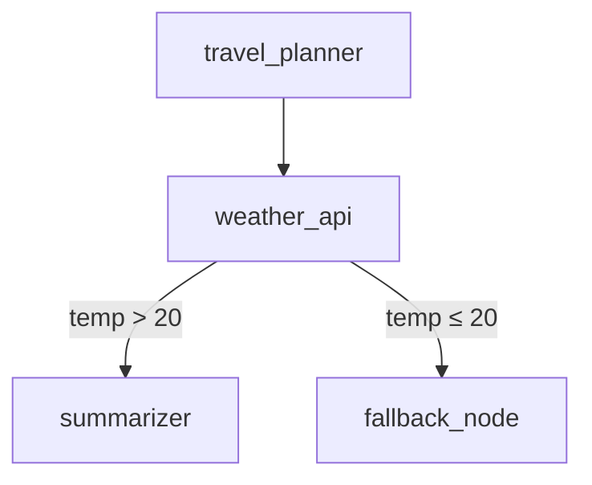

# How LangGraph Models Agent Workflows as Graphs  

---  

## Introduction  

- **Agentic AI** is moving beyond single‑turn LLM calls toward autonomous agents that can plan, act, and iterate.  
- As agents become more capable, their internal processes evolve into **branching, conditional pipelines**—a natural fit for graph‑based representation.  
- **LangGraph** extends the LangChain ecosystem with a lightweight, Pythonic framework that treats each step of an agentic workflow as a node in a directed graph, while edges encode transition logic and data flow.  

**What you’ll learn**  

1. Core graph concepts in LangGraph (nodes, edges, state, execution engine).  
2. Turning agents, tools, and custom functions into reusable nodes.  
3. Wiring conditional edges, loops, and recursion.  
4. Managing shared state safely across executions.  
5. Running, scaling, and monitoring LangGraph workflows in production.  

---  

## 1. Core Concepts  

| Concept | Role in a workflow | Typical implementation |
|--------|-------------------|------------------------|
| **Nodes** | Atomic step – an LLM chain, a tool call, or any Python function. | Subclass `Node` or wrap a LangChain `Runnable`. |
| **Edges** | Define *when* and *where* execution moves next. Include predicates, guards, and data‑mapping rules. | `Edge(source, target, condition=fn)`. |
| **State Management** | Mutable context that travels with the token flow (inputs, intermediate results, memory). | `Context` – a dict‑like store with optional versioning hooks. |
| **Execution Engine** | Traverses the graph according to a chosen strategy (depth‑first, breadth‑first, custom scheduler). | `GraphExecutor(strategy="dfs")` or a user‑provided scheduler. |

The engine repeatedly:

1. Pulls the current node.  
2. Executes it with the current `Context`.  
3. Evaluates outgoing edge predicates.  
4. Updates the context and moves to the next node(s).  

---  

## 2. Defining Nodes  

### 2.1 Turning a LangChain Agent into a Node  

```python
from langchain import OpenAI, LLMChain, PromptTemplate
from langgraph import Node

# Simple LLM chain that will act as an "agent" node
prompt = PromptTemplate.from_template(
    "You are a travel planner. {user_input}"
)
chain = LLMChain(llm=OpenAI(temperature=0), prompt=prompt)


class PlannerNode(Node):
    name = "travel_planner"
    description = "Generates a travel itinerary from a user request."

    async def run(self, ctx):
        # `ctx["input"]` holds the user utterance
        result = await chain.ainvoke({"user_input": ctx["input"]})
        ctx["itinerary"] = result["text"]
        return ctx
```

### 2.2 Wrapping an External Tool  

```python
import httpx
from langgraph import Node


class WeatherTool(Node):
    name = "weather_api"
    description = "Fetches current weather for a city."

    async def run(self, ctx):
        city = ctx["city"]
        async with httpx.AsyncClient() as client:
            resp = await client.get(f"https://api.weather.com/v3/{city}")
        ctx["weather"] = resp.json()
        return ctx
```

### 2.3 Registering a Custom Function  

```python
from langgraph import node


@node(name="summarizer", description="Summarizes a long text.")
def summarize(ctx):
    text = ctx["itinerary"]
    # Pretend we have a summarizer LLM
    ctx["summary"] = f"Short version of: {text[:100]}..."
    return ctx
```

### 2.4 Node Metadata  

| Field | Purpose |
|-------|---------|
| `name` | Unique identifier used in edge definitions. |
| `description` | Human‑readable purpose (useful for auto‑generated docs). |
| `input_schema` / `output_schema` | Optional Pydantic models that validate slices of the context before/after execution. |

---  

## 3. Connecting Nodes with Conditional Edges  

### 3.1 Linear vs. Branching  

A declarative edge specification can be stored in YAML (or JSON) and loaded at runtime:

```yaml
# graph.yaml
nodes:
  - travel_planner
  - weather_api
  - summarizer

edges:
  - source: travel_planner
    target: weather_api                     # always follow
  - source: weather_api
    target: summarizer
    condition: ctx["weather"]["temp_c"] > 20   # only if warm
```

### 3.2 Predicates & Guards  

```python
def is_high_confidence(ctx) -> bool:
    """Proceed only when the planner is confident enough."""
    return ctx.get("confidence", 0) > 0.8
```

```python
graph.add_edge(
    source="travel_planner",
    target="summarizer",
    condition=is_high_confidence,
)
```

### 3.3 Loops & Recursion  

```python
# Re‑run the planner until confidence exceeds 0.9
graph.add_edge(
    source="travel_planner",
    target="travel_planner",
    condition=lambda ctx: ctx.get("confidence", 0) <= 0.9,
)
```

### 3.4 Visualizing the Graph  



---  

## 4. Managing State Across the Workflow  

### 4.1 Immutable vs. Mutable State  

| Approach | Pros | Cons |
|----------|------|------|
| **Immutable** (return a new `Context` each node) | Easy to reason about; perfect for debugging. | Higher memory usage. |
| **Mutable** (modify the same `Context` in‑place) | Faster and more memory‑efficient. | Requires disciplined access to avoid race conditions. |

LangGraph defaults to mutable state but can take snapshots before each node run for safe rollback.

### 4.2 Using the `Context` Object  

```python
from langgraph import Context

ctx = Context()
ctx["input"] = "Plan a 3‑day trip to Tokyo."
ctx["metadata"] = {"request_id": "1234"}
```

- Access values via `ctx["key"]`.  
- Store large blobs (e.g., PDFs) in an external object store and keep only a reference in the context.

### 4.3 Cleanup & Versioning  

```python
def cleanup(ctx):
    for key in ["temp_data", "intermediate_steps"]:
        ctx.pop(key, None)
    return ctx
```

Enable automatic snapshots:

```python
executor = GraphExecutor(snapshot=True)   # Allows rollback on failure
```

### 4.4 Debugging State Transitions  

* **Structured logs** – each node can emit `ctx.log("msg", level="debug")`.  
* **Snapshots** – `executor.get_snapshot(step_id)` returns the full context at that point.  
* **Diff CLI** – `lg diff <snapshot1> <snapshot2>` prints a JSON diff of two snapshots.  

---  

## 5. Running and Scaling Graphs  

### 5.1 Execution Modes  

| Mode | When to use |
|------|-------------|
| **Synchronous** (`run()`) | Simple scripts, debugging, low‑latency single‑request flows. |
| **Asynchronous** (`arun()`) | I/O‑bound tools (APIs, DB calls) or integration with async web frameworks. |
| **Parallel Sub‑graphs** | Independent branches that can be executed concurrently. |

```python
# Asynchronous run with parallel branches
await executor.arun(ctx, parallel=True)
```

### 5.2 Concurrency Controls  

```python
from langgraph import Semaphore

# Limit concurrent weather‑API calls to 5
weather_sema = Semaphore(max_permits=5)


@node(name="weather_api")
async def weather_api(ctx):
    async with weather_sema:
        # perform API call
        ...
    return ctx
```

### 5.3 Deploying to the Cloud  

| Platform | Containerization | Entry point |
|----------|------------------|-------------|
| **AWS Lambda** | Docker image (`FROM public.ecr.aws/lambda/python:3.11`) | `handler(event, context)` calls `executor.run(event["context"])`. |
| **GCP Cloud Run** | Same Docker image | HTTP endpoint that receives a JSON payload and returns the final context. |
| **Kubernetes** | Helm chart supplied by LangGraph (`langgraph-chart`) | Scales automatically with an HPA based on request latency. |

### 5.4 Monitoring, Tracing, & Error Handling  

```python
# Retry policy on a flaky tool
from langgraph import retry

@retry(max_attempts=3, backoff=2)
@node(name="unstable_api")
def unstable_api(ctx):
    # May raise; retry logic is applied automatically.
    ...
```

- **Tracing** – LangGraph integrates with OpenTelemetry; each node emits a span named `node.{name}`.  
- **Fallback nodes** – define a low‑priority edge with `condition=lambda ctx: True` that points to a safe‑exit node.  

---  

## Conclusion  

LangGraph turns the often‑implicit choreography of autonomous agents into an **explicit, inspectable graph**:

* **Transparency** – every transition is declared, making intent obvious.  
* **Modularity** – agents, tools, and custom logic are interchangeable nodes.  
* **Debuggability** – immutable snapshots, visual diffs, and OpenTelemetry traces surface failures quickly.  
* **Scalability** – parallel sub‑graphs, async execution, and cloud‑native deployment let you run large, multi‑step workflows at production scale.  

### Next Steps  

1. Clone the LangGraph starter repository and build the “Travel Planner” graph from the examples above.  
2. Experiment with **dynamic graph generation** (adding nodes at runtime based on LLM output).  
3. Join the community Slack channel, share your graph definitions, and contribute new node adapters.  

*Ready to give your agents a graph‑powered backbone?* Build a simple LangGraph workflow today and let the community see what you create!  